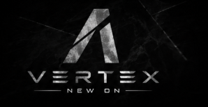

<div align="center">



# VXCore

Panel de control open source para servidores FiveM, RedM y Open77.

[](https://github.com/Reysel1/VXCore-App/actions/workflows/ci.yml)
[](https://github.com/Reysel1/VXCore-App/actions/workflows/codeql.yml)
[](https://scorecard.dev/viewer/?uri=github.com/Reysel1/VXCore-App)
[](LICENSE)

</div>

## Qué hace

- Arranca, para y reinicia el servidor con consola en vivo, logs y diagnóstico.
- Crea un servidor desde cero o importa uno existente a partir de su `server.cfg`.
- Jugadores conectados, historial, identificadores, vista de pantalla y sanciones (ban, kick, warn) que se aplican también al entrar.
- Recursos: activar, parar, instalar desde GitHub y editar ficheros con un editor integrado.
- Base de datos MySQL/MariaDB del servidor: tablas, consultas y fichas de jugador.
- Inicio de sesión con Discord, roles y enlaces de invitación para el staff, con permisos por sección.
- Automatizaciones, tablero de tareas, changelog conectado a GitHub y anuncios en el juego.
- Asistente con IA (Anthropic, Ollama o cualquier API compatible con OpenAI) que lee los recursos y propone cambios.
- Menú in-game para el staff (F5) escrito en React, con los mismos permisos que el panel.
- Interfaz en español, inglés, portugués, francés y alemán.
- Aplicación de escritorio para Windows con actualizaciones automáticas.

## Arquitectura

| Pieza | Carpeta | Tecnología |
| --- | --- | --- |
| Panel | `src/` | Next.js 16, React 19, Tailwind |
| Agente | `agent/` | Node.js, Express 5, Socket.IO |
| Escritorio | `desktop/` | Electron |
| Recurso in-game | `vxcore/` | Lua |
| Menú in-game | `fiveos-nui/` | React + Vite, compilado en `vxcore/source/nui/assets` |

El panel no toca el disco ni los procesos: todo pasa por el agente, que corre en la misma máquina que el servidor de juego y escucha solo en `127.0.0.1` salvo que se configure lo contrario.

## Instalación

### Windows

Descarga `VXCore-Setup-<versión>.exe` desde [Releases](https://github.com/Reysel1/VXCore-App/releases) y ejecútalo. El instalador incluye el panel, el agente, el recurso in-game y `cloudflared`; no hace falta tener Node instalado.

Cada release publica sus sumas SHA-256 y una atestación de procedencia de GitHub, así que puedes comprobar que el instalador sale de este repositorio:

```bash
gh attestation verify VXCore-Setup-<versión>.exe --repo Reysel1/VXCore-App
```

### Desde el código

Requisitos: Node.js 22 o superior.

```bash
git clone https://github.com/Reysel1/VXCore-App.git
cd VXCore-App
npm ci
npm --prefix agent ci
npm --prefix fiveos-nui ci
cp agent/.env.example agent/.env

npm --prefix agent run dev   # agente en http://localhost:4000
npm run dev                  # panel en http://localhost:3000
```

### Recurso in-game

El panel lo instala desde *Ajustes → Agente & In-Game*. A mano: copia `vxcore` a la carpeta `resources` de tu servidor y añade a `server.cfg`:

```cfg
ensure vxcore
set vxcore_agent_url "http://localhost:4000"
```

El permiso `vxcore.menu` se concede a `group.admin` al arrancar el recurso. Si cambias el menú, recompílalo con `npm run nui:build`.

## Configuración

Todo se puede configurar desde el panel. Lo que pongas en `agent/.env` tiene prioridad y queda bloqueado en la interfaz.

| Variable | Uso |
| --- | --- |
| `DISCORD_CLIENT_ID`, `DISCORD_CLIENT_SECRET` | Aplicación OAuth2 de Discord |
| `DISCORD_BOT_TOKEN`, `DISCORD_GUILD_ID` | Bot y servidor de Discord para roles y estado |
| `FIVEOS_PUBLIC_URL` | Dirección pública del agente (redirect URI de Discord) |
| `FIVEOS_ALLOWED_ORIGINS` | Orígenes extra que pueden usar el agente |
| `HOST`, `PORT` | Dirección y puerto del agente (`127.0.0.1:4000`) |
| `FIVEOS_GAME_KEY` | Clave para servidores de juego en otra máquina |
| `FIVEOS_TUNNEL_HOSTNAME`, `FIVEOS_TUNNEL_CREDENTIALS` | Túnel propio de Cloudflare |
| `FXSERVER_BIN` | Ruta a `FXServer.exe` si no se detecta sola |

Si el servidor de juego corre en otra máquina, define `FIVEOS_GAME_KEY` en el agente y la misma clave en `server.cfg` con `set vxcore_agent_key "..."`. Usa `set`, no `setr`, para que no llegue a los clientes.

## Acceso remoto

VXCore puede publicar el panel con un túnel de Cloudflare, sin abrir puertos. Necesitas una cuenta gratuita de Cloudflare con un dominio:

```bash
cloudflared tunnel login
cloudflared tunnel create vxcore
cloudflared tunnel route dns vxcore panel.tudominio.com
```

Después, en *Ajustes → Acceso remoto*, pega el dominio y el contenido del `.json` que ha creado `cloudflared`. El túnel no arranca hasta que hay una cuenta de Discord vinculada y el inicio de sesión es obligatorio.

## Seguridad

- Sesiones firmadas con HMAC-SHA256 y comparación en tiempo constante, también en el canal en vivo.
- Control de acceso por nivel (dueño, admin, moderador) y por sección en cada ruta, en el canal en vivo y en el menú in-game.
- Comprobación de `Origin` y de `Host` contra CSRF y DNS rebinding.
- Rutas de ficheros limitadas a los servidores dados de alta, sin salir por `..` ni por enlaces simbólicos.
- Los moderadores nunca reciben el `server.cfg` ni las credenciales de la base de datos.
- Límite de intentos en el inicio de sesión.
- Electron con `contextIsolation`, sin `nodeIntegration` y con una superficie de IPC mínima.
- CodeQL, Dependabot y `npm audit` en cada cambio.

Para informar de una vulnerabilidad, lee [SECURITY.md](SECURITY.md).

## Desarrollo

| Comando | Qué hace |
| --- | --- |
| `npm run dev` | Panel en modo desarrollo |
| `npm --prefix agent run dev` | Agente en modo desarrollo |
| `npm run lint` | ESLint |
| `npm run typecheck` | Comprobación de tipos del panel |
| `npm test` | Pruebas del agente |
| `npm run i18n:check` | Comprueba que todas las traducciones están completas |
| `npm run build` | Compila el panel |
| `npm run nui:build` | Compila el menú in-game en `vxcore/source/nui/assets` |
| `npm run desktop:build` | Genera el instalador de Windows en `dist-desktop/` |

Para publicar una versión, sube la versión en `package.json` y crea una etiqueta:

```bash
git tag v0.10.41
git push origin v0.10.41
```

El workflow `release` compila el menú in-game y el instalador, genera la atestación de procedencia y lo publica en Releases junto a `latest.yml`, que es lo que lee el actualizador de la app.

## Contribuir

Las contribuciones son bienvenidas. Lee [CONTRIBUTING.md](CONTRIBUTING.md) antes de abrir un pull request.

## Licencia

[MIT](LICENSE)
